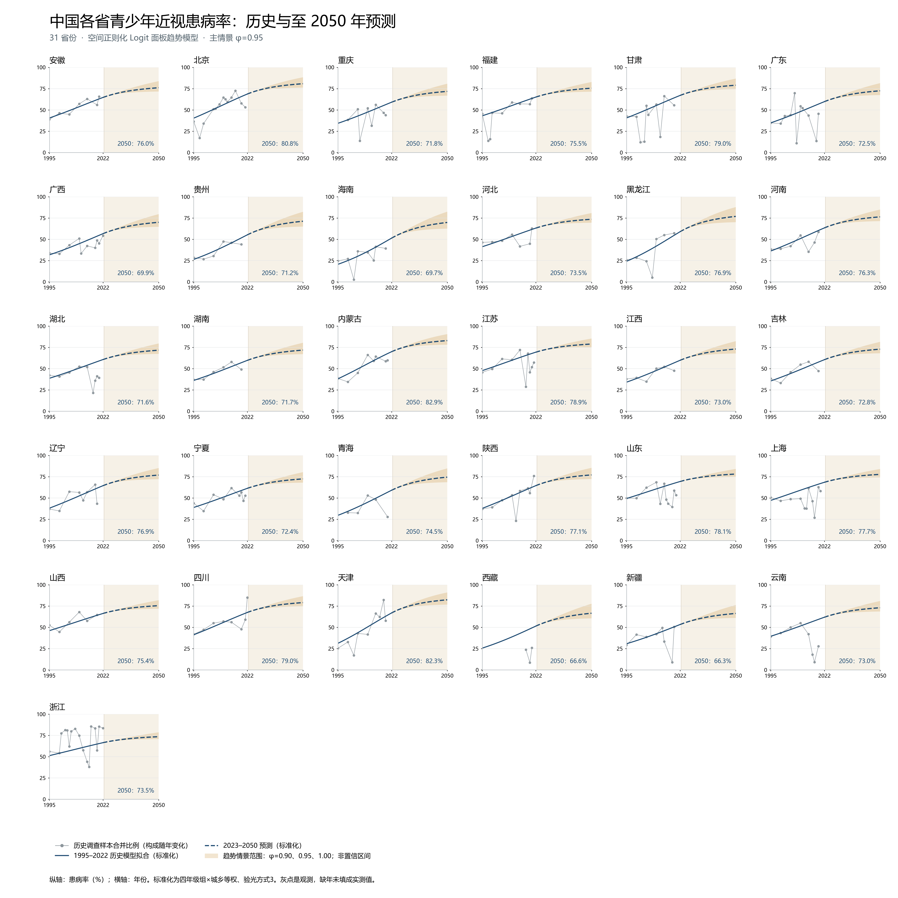

# 中国青少年近视患病率预测至 2050 年

结合时间趋势和省际空间信息，使用 1995–2022 年的省级面板数据，预测各 panel 在 2023–2050 年的近视患病率。由 Codex（基于 GPT-6）协助完成，所有数值由 Python 计算。

## 主要文件

| 文件 | 内容 |
| --- | --- |
| [metrics.csv](metrics.csv) | 严格按时间向前的十折交叉验证，各折五项指标及算术均值 |
| [predictions_future.csv](predictions_future.csv) | 534 个 panel、2023–2050 年，共 14,952 行预测 |
| [province_forecasts_300dpi.png](province_forecasts_300dpi.png) | 31 省历史观测、历史拟合和预测曲线，300 dpi |
| [预测说明_Codex.docx](预测说明_Codex.docx) | 约 500 字的方法、结果及不确定性说明 |
| [methodology.md](methodology.md) | 完整数据处理、模型、验证和局限 |
| [input/06_myopia.zip](input/06_myopia.zip) | 本次使用的原始数据包 |
| [model_forecast.py](model_forecast.py) | 数据处理、空间模型、十折验证与预测代码 |
| [build_report.py](build_report.py) | Word 与方法文档生成代码 |
| [verify_outputs.py](verify_outputs.py) | 从逐条验证预测独立重算指标、核验输出 |
| [verification.json](verification.json) | 已通过的 25 项核验记录 |
| [delivery_manifest.json](delivery_manifest.json) | 原交付文件及输入包的 SHA-256 清单 |

`cv_predictions.csv` 保存逐折预测，`nested_cv_selection.json` 保存训练期内选参记录；覆盖度、基准比较和远期回测也一并保留。

## 验证结果

没有打乱年份。同一年所有省份同时归入训练集或测试集；训练年份严格早于测试年份。每折参数仅在该折训练集内通过内部向前验证选择。最终评估为十折指标的等权算术均值。

| 指标 | 十折均值 |
| --- | ---: |
| MSE | 0.019942 |
| RMSE | 0.138795 |
| MAE | 0.107297 |
| MAPE | 50.49% |
| R² | 0.6815 |

RMSE 约为 13.88 个百分点，精度尚不令人满意。17 年期补充回测的 RMSE 约为 31.0 个百分点，且测试样本很少；短期交叉验证不能证明 2050 年预测可靠。

## 方法与解释边界

以 `computed_prevalence` 为目标，剔除无效目标；同 panel 同年多项研究按病例数与样本量合并。模型在 Logit 尺度控制年级、城乡、验光方法及交互项，估计省份截距与趋势，以省际距离的近邻图施加空间平滑惩罚。未来趋势每年按 0.95 衰减，逆变换将预测约束在 0–1。

2022 年仅 3 省有有效观测；59 个原始 panel 没有有效历史目标，其预测依赖共享特征。图中蓝线统一四年级组×城乡的等权构成与验光方法，不能解释为人口加权全国患病率。金色带为趋势假设敏感性范围，没有置信区间的概率含义。完整细节见 [methodology.md](methodology.md)。



## 复现

推荐使用 Python 3.13。在仓库根目录执行：

```powershell
python -m venv .venv
.\.venv\Scripts\Activate.ps1
python -m pip install -r requirements.txt
python model_forecast.py --input input/06_myopia.zip --out reproduced
python build_report.py --input input/06_myopia.zip --out reproduced
python verify_outputs.py --input input/06_myopia.zip --out reproduced
```

也可以对仓库中已有的结果直接运行：

```powershell
python verify_outputs.py --input input/06_myopia.zip --out .
```

图中文字优先使用 Microsoft YaHei，其他平台需安装可用中文字体。Word 版面核查记录来自本次渲染后的视觉检查；重新生成的 Word 需要重新渲染检查。`reproduced/` 为本地复现输出目录，已从版本控制中排除。

## 协作

请从 `main` 创建工作分支，通过 Pull Request 提交模型或文档改动。比较模型时沿用相同的时间划分与目标定义，保留逐折指标，并在模型变化后重新生成配套结果。
